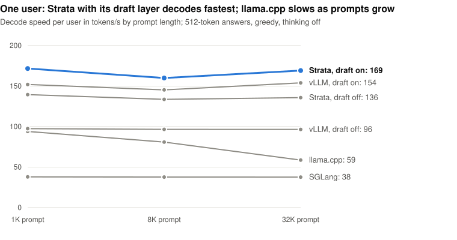
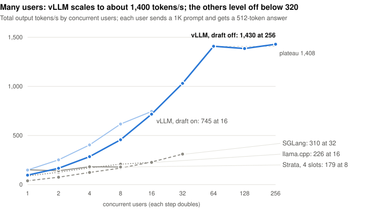

# One GPU, a 125B model, four engines: which one should you run?

*Qwen3.8-Flash-Next at 4 bits on one 96 GB RTX PRO 6000, tested with vLLM, SGLang, Strata and llama.cpp. October 2026.*

**Short answer: use vLLM with its draft layer.** It gives the first word soonest, finishes a typical answer first, and
can serve a whole team from one card. Strata types the fastest once it gets going, llama.cpp is the easiest on memory,
and SGLang is held back by a bug for now.

## Why I ran this

A 96 GB card can now hold a 125-billion-parameter model, if you store each weight in 4 bits instead of 16. The question
is what to run it with. Several engines can serve the model, and they make very different trade-offs.

People had already tested part of this. A [community benchmark](https://github.com/lukaLLM/Qwen3.8-Flash-Next-VRAM-Benchmark)
measured llama.cpp and SGLang on this exact card, but had no vLLM result and did not check whether the answers stayed
good. The official [vLLM](https://recipes.vllm.ai/Qwen/Qwen3.8-Flash-Next) and
[SGLang](https://docs.sglang.io/cookbook/autoregressive/Qwen/Qwen3.8-Flash-Next) guides cover other setups: bigger
multi-GPU servers, or a 4-bit format meant for datacenter racks.

So I ran four engines on the same card with the same prompts, and also checked the answers. Here is what came out.

## How a 125B model fits on one card

Three things make it fit.

**Only a small part of the model works on each word.** Qwen3.8-Flash-Next is a mixture-of-experts model: its weights
are split into 512 "experts", and each word only goes through a few of them, about 6B weights in all. That is why it
can be fast. It does not make the model smaller, though. All 125B weights still have to be loaded.

**Each weight is stored in 4 bits.** At 16 bits the model would need about 250 GB; at 4 bits it needs about 70 GB.
I tested the two 4-bit versions most people use: Intel's AutoRound (for vLLM and SGLang) and Unsloth's UD-Q4_K_XL
(for Strata and llama.cpp). Both keep the most sensitive parts of the model at higher precision.

**A big lookup table stays in normal memory.** The model also has a 48 GB table that it only looks up a few rows from
per word, like a dictionary. Every engine keeps it in the computer's RAM instead of on the card. That frees the card
for the parts that do the heavy maths, but it means you need 43 to 84 GB of free RAM as well.

With all that, every engine fit, using 80 to 92 GB of the card's 96 GB.

## Speed for one person

Two numbers matter when you chat with a model. **Time to first word** is how long you wait before anything appears;
most of it is the model reading your prompt. **Typing speed** is how fast words come after that, in tokens per second
(a token is about three quarters of a word).

The model also has a **draft layer**: a small extra part that guesses the next few words, which the full model then
checks in one go. Guesses that are right are kept, so you get the same answer in fewer steps.

<picture>
  <source media="(prefers-color-scheme: dark)" srcset="figures/one_user_dark.svg">
  
</picture>

**Strata types the fastest:** about 170 tokens per second with its draft layer, against about 150 for vLLM. Both keep
that speed with a long prompt. llama.cpp slows down as the prompt grows, from 94 to 59 tokens per second at 32K tokens
(roughly a 50-page document). The draft layer is worth having: it made vLLM 50 to 60% faster and Strata 20 to 25%.

**But vLLM starts much sooner.** It reads a long prompt two to three times faster than Strata, which matters more than
it sounds. For an answer of 512 tokens, about a page of text:

| Prompt | vLLM, draft on | Strata, draft on | llama.cpp |
| --- | --- | --- | --- |
| Short (1K tokens) | 3.5 s | 3.7 s | 5.9 s |
| Long (32K tokens) | 5.8 s | 9.4 s | 21.1 s |

So vLLM finishes first. Strata only catches up when answers run past about 760 tokens, and later still with long prompts.

## Speed for a team

A server rarely has one user. When many people send requests, the engine works on all of them together: it reads the
model once per step and uses it for everyone's next word. Total output then grows with the number of users, until the
card runs out of compute.

<picture>
  <source media="(prefers-color-scheme: dark)" srcset="figures/many_users_dark.svg">
  
</picture>

**vLLM is the only one built for this.** It kept growing to about 1,400 tokens per second at 64 users. At 32 users
each person still saw 35 tokens per second, faster than most people read. The others levelled off between 180 and
310 tokens per second. Strata is designed for a few people on a home PC, and its setup tool recommends just 4 parallel
requests on this card.

## Does 4 bits hurt the answers?

Not measurably. I asked each setup the same 550 questions: 250 grade-school maths problems
([GSM8K](https://huggingface.co/datasets/openai/gsm8k)) and 300 harder multiple-choice questions across many subjects
([MMLU-Pro](https://huggingface.co/datasets/TIGER-Lab/MMLU-Pro)).

| | Maths | Multiple choice |
| --- | --- | --- |
| AutoRound 4-bit, on vLLM | 97.6% | 85.3% |
| UD-Q4_K_XL 4-bit, on Strata | 97.2% | 82.7% |

The 2.6-point gap on the multiple-choice test is within what chance can produce with 300 questions. A fairer summary
is that both 4-bit versions answer about as well as each other. (Confidence intervals and a paired test are in the
[reference](docs/reference.md#quality).)

## What went wrong

None of the four engines worked well straight out of the box. These are the problems worth knowing about:

- **vLLM's draft layer did nothing at first.** The 4-bit download ships without the draft layer's weights, so its
  guesses were always wrong and vLLM got slower. Pointing it at Intel's separate copy of those weights fixed it
  ([how](configs/make_mtp_draft.sh)).
- **SGLang ran out of memory right after loading.** It keeps an old copy of the weights while converting them, a known
  bug with a fix that has not been merged ([#38900](https://github.com/sgl-project/sglang/pull/38900)). A setting
  sends it down a slower path that works, which is why it was 2.6 to 3.3 times slower than vLLM.
- **Strata sometimes took a minute to start answering.** By default it saves every finished conversation in case you
  come back to it. With many unrelated long prompts that store filled up, and new prompts waited. Sending
  `"strata_checkpoint": false` with one-off requests fixed it, and 32K prompts then took 6.4 s instead of 60 to 90.
- **llama.cpp was slow until told to load everything up front.** By default it read the lookup table from disk while
  answering. Two flags fixed it (`--load-mode none --tensor-read-lazy off`).

The full list, with the exact error messages to search for, is in the [reference](docs/reference.md#gotchas).

## So, which engine?

Back to the question I started with. On one 96 GB card:

- **vLLM with its draft layer, for most people.** First word soonest, a page of text first, and room for a team.
- **Strata, if one person wants the fastest typing on long answers.** Turn off its saved conversations for one-off
  requests.
- **llama.cpp, if your computer is short on RAM.** It needed 43 GB, against 73 to 84 GB for the others.
- **SGLang, after its memory fix lands.** Today it is the slowest of the four on this setup.

How this compares with what people reported before:

| Earlier report | This test |
| --- | --- |
| llama.cpp slows down with long context ([community benchmark](https://github.com/lukaLLM/Qwen3.8-Flash-Next-VRAM-Benchmark)) | Confirmed: 94 tokens/s at 1K, 59 at 32K |
| llama.cpp reads a 32K prompt at about 2,600 tokens/s (same source) | Matches: 2,640 tokens/s |
| Strata advertises fast typing on single cards ([its docs](https://github.com/Niko1221/Strata/blob/main/docs/NVFP4.md)) | True here too, but it starts 2.6 to 6.6 times later than vLLM |
| The official vLLM guide has no single-card setup at 4-bit weights | It works with two settings and is the fastest overall |

## Try it yourself

Each engine has a launch script in [configs/](configs), and the benchmark tools are in [bench/](bench):

```bash
./configs/vllm.sh install && ./configs/vllm.sh draft-on          # start a server
tar xJf data/prompts-and-questions.tar.xz                         # the exact prompts used here
python bench/run_suite.py --url http://127.0.0.1:8000 --name my-run
```

Setup details, every number, all the fixes and the method are in [docs/reference.md](docs/reference.md). Raw
per-request timings for every run are in [results/](results).

Hardware: one NVIDIA RTX PRO 6000 Blackwell Server Edition (96 GB) in a rented cloud machine with 48 CPU cores and
176 GB RAM. Software: vLLM 0.32.0, SGLang 0.5.22, Strata 0.2.7.1, llama.cpp b10666.

*Code: MIT. Results: CC BY 4.0. Prompts come from public-domain [Project Gutenberg](https://www.gutenberg.org) books.
No model weights are included. The tests and this write-up were done with help from an AI coding assistant; every
number comes from the files in [results/](results).*
